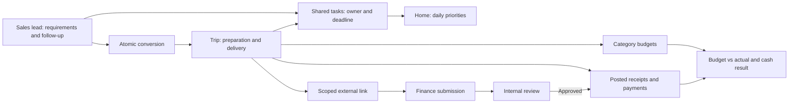
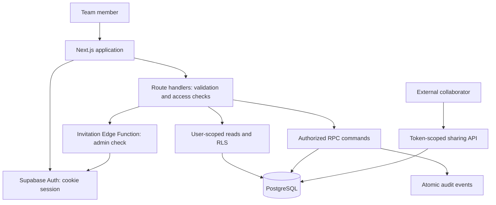

# travelOS · Egimu Travel

An invite-only workspace connecting travel sales, trip delivery, team responsibilities, and cash records. Built for Egimu Travel, it gives a small team one place to follow a booking from its first enquiry to operational and financial closeout.

**Status:** implemented application with a real Supabase backend; production deployment and full operational acceptance remain unverified. The interface uses Indonesian labels and IDR amounts. Public source does not grant access to the team's workspace.

## Why we need it

A travel booking connects customer follow-up, itinerary preparation, vendor coordination, and payments. When these live in separate messages, documents, boards, and spreadsheets, every handover requires reconstructing context. Missed follow-ups risk lost bookings; outdated itineraries disrupt delivery; missing payments distort the cash position.

Travel OS connects work to its lead or Trip, keeping commitments visible as departure approaches. It makes **tupoksi—core duties and responsibilities—**practical through ownership, deadlines, access, and reviewable changes. These are intended benefits, without measured productivity or revenue claims.

| Responsibility | Workspace support | Why it matters to us |
| --- | --- | --- |
| Sales / person in charge (PIC) | Enquiries, follow-ups, client requirements, quotation, conversion | Operations inherits the agreed context. |
| Trip operations | Dates, guests, itinerary, contacts, tasks, delivery status | Preparation and departure commitments stay visible. |
| Finance | Receipts/payments, budgets, corrections, submission review | Recorded cash stays distinct from plans and quotations. |
| Administrator | Invitations, privileges, configuration, audit history | Responsibility comes with controlled access and oversight. |
| Each team member | A personal Home task board across work contexts | Daily priorities stay visible across multiple bookings. |

These are working responsibilities, not hardcoded departments. One person can cover several functions; administrators still need explicit module privileges.

## From enquiry to closeout



Lead conversion copies operational documents, preserves unfinished task IDs, and archives the source in one database transaction. It creates **no cash entry**: winning a booking and receiving payment are separate events.

## Why Asana or Notion alone does not close the gap

[Asana supports custom fields, formulas, and rules](https://help.asana.com/s/article/organize-projects-with-custom-fields); [Notion supports relations and rollups](https://www.notion.com/help/relations-and-rollups). Both organize parts of this workflow. Our assessment concerns fit: either still requires us to design and validate the travel-specific rules below.

| Our requirement | What a general workspace still needs us to build | Travel OS behavior |
| --- | --- | --- |
| Sales-to-operations handover | Linked records, copied documents, task continuity, duplicate prevention | One atomic conversion preserves the handover. |
| Financial integrity | Cash semantics, exact amounts, correction approval, void rules | A separate IDR ledger with enforced posting and review. |
| External collaboration | Guest access separating operational content from internal finances | Expiring per-tab links; public Finance receives submissions. |
| Consistent authority | Permissions coordinated across tasks, documents, sales, and money | Current membership and module privileges checked in the database. |

Both remain useful for general planning. Travel OS fits this connected workflow more directly, at the cost of maintaining our own software and infrastructure.

## Features and their purpose

| Area | Implemented behavior | Operational value |
| --- | --- | --- |
| **Home** | Assigned → Doing → Done tasks; personal manual card order; deadline warnings; date/context filters; personal unfinished count; admin team filters; Load More | Reveals the next action across leads, Trips, and internal work. |
| **Sales CRM** | Drafts → Contacted → Prospect defaults; drag/menu moves; PIC, fields, notes, contacts, itinerary drafts; Lost/archive/restore; stage analytics | Keeps follow-up and booking context together. Stage movement never creates a Trip. |
| **Trips** | Planned → Confirmed → In Progress defaults; departure/name sorting and personal manual card order; automatic H−2 advancement; completed/cancelled archive; board/calendar; stage configuration; ordered itinerary days/items | Turns a sale into a delivery plan. Calendar ranges include both start and end dates. |
| **Finance** | IDR transactions; filters/pagination; overall/per-Trip cash results; month/quarter comparison charts; category budgets; correction requests; admin approval/void; CSV export | Supports cash control and traceable changes without treating plans as money received. |
| **Internal Docs** | Searchable table; column filters/sorting; Markdown/WYSIWYG; templates; Edit/Save/Cancel; selected/bulk deletion; view-only snapshots | Keeps instructions reusable. Template changes do not rewrite existing documents. |
| **Contacts** | Directory from accessible leads, Trips, and internal contacts; search/source links; reuse picker; linked edits; selected deletion | Reduces repeated entry while preserving identity and permission-aware context. |
| **Team & Settings** | Invitations; multiple admins; view/edit/none privileges; deactivation/reassignment; last-admin protection; stage/category/template configuration; readable audit diffs | Provides controlled access and accountable administration. No application member cap is imposed. |
| **Sharing** | Expiring/revocable live Trip links; Hidden/Viewer/Editor tabs; Public tasks; reviewed Finance submissions; separate document snapshots | Lets external collaborators contribute within a deliberate scope. |

Docs/itineraries open in view mode; failed saves retain drafts. Drag interactions have menu alternatives, layouts support narrow screens, and motion respects reduced-motion preferences. Refresh pauses during editing.

## Rules that protect the workflow

- **Cash result = posted money in − posted money out.** Rp 10 million received minus Rp 7 million paid means Rp 3 million net cash, not accrual profit: categories include financing/owner movements. Quotes/budgets, pending changes, rejected submissions, and voided entries do not enter posted totals.
- **IDR only, up to two decimals.** Decimal strings, integer hundredths, and PostgreSQL numeric arithmetic preserve precision. Formula-protected CSV exports cover all matching rows.
- **Time contexts:** UTC timestamps display in browser time; date-only fields retain their date. Workspace time (Asia/Jakarta by default) governs deadlines and H−2: Confirmed Trips advance two calendar days before departure.
- **Scoped public access:** enabled tabs expose their content; Notes default to Hidden. Guests see non-cancelled Public tasks and their link's Finance submissions, never the ledger/budgets/totals. A Finance editor with Trip access can approve a submission into cash once, atomically.
- **Sharing modes:** live Trip permissions take effect immediately; document/Contacts snapshots require republication. Public URLs use a title slug and a 22-character random suffix. Authorized editors can copy an existing active link again. Private sharing tables hold both a token hash and a recoverable capability; these URLs are credentials and must not appear in logs or audit metadata. Legacy URLs remain valid alongside short aliases until expiry or revocation. `SHARING_ENABLED` and the workspace gate control legacy static Trip snapshots, not live links or Docs snapshots.
- **Revocation:** revoked sharing rows and obsolete snapshots are permanently removed. Finance submissions remain reviewable with their link reference cleared; posted transactions and audit events remain intact. Revoked links disappear from sharing panels. Login/invitation records and their one-time authentication behavior are outside this cleanup.
- **Kanban order:** cards can be placed above/below another card or moved between groups. Trips support nearest/farthest departure, name A–Z/Z–A, and Manual. Dragging activates Manual; each user's saved order is restored on fresh requests. Filtering keeps saved IDs outside the visible subset; the reordered visible subset is placed ahead of those remaining IDs. Cross-group status changes and order saves commit together, with the original permissions and version checks.

## Stack and architecture

| Layer | Technology | Purpose |
| --- | --- | --- |
| Application | Next.js **16.4.0**, React **19.3.0**, TypeScript **5.9.3** | App Router, server rendering, route handlers, typed contracts. |
| Backend | Supabase Auth, PostgreSQL, `supabase-js`, `@supabase/ssr` | Cookie sessions, persistence, RLS, audited commands. |
| UI | Modular CSS, Tailwind CSS 4 tooling, Radix Dialog, Lucide, Plus Jakarta Sans | Shared styling, dialogs, icons, typography. |
| Interaction | BlockNote 0.56, dnd-kit, Recharts | Rich text, boards/itineraries, analytical charts. |
| Validation/content | Zod, react-markdown, unified/remark/rehype | Input contracts and sanitized Markdown. |
| Verification | Node test runner via tsx, Testing Library, jsdom, PGlite | Unit/component and executable PostgreSQL checks. |
| Operations | Supabase Edge Function, PostgreSQL Cron; optional Vercel hosting | Invitations, scheduled transitions, application hosting. |

Dependencies are pinned in `package.json` and `package-lock.json`.



Leads/Trips share `journeys` with an immutable kind. Notes and itineraries use versioned JSONB; tasks, cash, budgets, and Docs have separate records. Contacts now have one canonical row in `public.contacts`, with ordered many-to-many links in `public.journey_contacts`. A workspace enforces unique normalized contact names. Shared edits update the canonical row and invalidate linked journey versions; removing a contact from one journey only removes that link. The directory shows accessible sources, and public Trip links cannot browse the workspace directory or change a contact shared with other records. The old `data.contacts` field remains an empty compatibility placeholder, while `private.internal_contacts` is a read-only projection of the new tables. See [contact storage and reset](CONTACTS.md).

Reads use the member's credentials. Checked RPCs enforce membership, fields, workspace consistency, and versions, committing writes with audit events; direct member table writes are denied. Parent-level versions may conflict across different embedded documents. Workspace locks favor consistency; large-team throughput is unmeasured.

Requests check Origin/body limits and use private/no-store caching. Markdown is sanitized; public document images are removed. Each valid share link has a 300-request/minute budget; deployed cache/log/load behavior remains unverified.

## Run locally

Use Node.js **24.15+**, or **22.22.2+**, and a dedicated Supabase project. An empty installation requires an administrator; there is no public signup or demo login.

```bash
npm ci
```

Copy [`.env.example`](.env.example) to `.env.local`. Set the Supabase URL/publishable key, `APP_URL=http://127.0.0.1:3000`, and seeded `WORKSPACE_ID`. The defaults use manual invitations and disabled email recovery. A secret/service-role key is optional for owner bootstrap or local invitation handoff; keep it server-only.

<details>
<summary>Database, authentication, and first-admin setup</summary>

1. Apply [`supabase/migrations`](supabase/migrations) in filename order, then [`supabase/seed.sql`](supabase/seed.sql). Seed creates only the workspace/categories. Check the scheduled Trip transition job.
2. Disable public signup and anonymous sign-ins in Supabase Auth; keep email/password sign-in and email confirmation enabled. Set Site URL to `APP_URL`, allow the intended callback—locally `http://127.0.0.1:3000/auth/callback**`—and set `workspaces.app_url` to the same application origin.
3. Deploy [`send-invitation`](supabase/functions/send-invitation). It verifies active-admin authority. Manual mode shows a link once for copying, without sending email. Regeneration invalidates the previous generation; recipients choose passwords. Expired/revoked invitations cannot activate membership.
4. Create a confirmed email/password user in Supabase Auth. Replace `YOUR_EMAIL` and `YOUR_NAME` in [`bootstrap-first-admin.sql`](supabase/bootstrap-first-admin.sql), then run it in the SQL Editor. Alternatively, configure `SUPABASE_SECRET_KEY` locally and run `npm run bootstrap -- --email YOUR_EMAIL --name YOUR_NAME`. Bootstrap refuses when an active admin exists.
5. Email delivery/recovery is deferred by default. To enable it, configure SMTP, set `INVITATION_DELIVERY=email` and `EMAIL_DELIVERY_ENABLED=true`, and validate delivery. Email links must append `&token_hash={{ .TokenHash }}&type=invite` or `&token_hash={{ .TokenHash }}&type=recovery` to `{{ .RedirectTo }}`; the redirect already contains the application's flow query.

Keep credentials, activation URLs, and share tokens local. Recovery directs users to the administrator while email recovery is disabled.

</details>

```bash
npm run dev
```

Open [http://127.0.0.1:3000](http://127.0.0.1:3000) and sign in. Hosting uses `npm run build` and `npm run start`, or a Vercel import. Configure the HTTPS origin, matching Auth callbacks, environment, Edge Function, and database before acceptance testing.

## Verification and remaining scope

Notes and document templates use a minimal BlockNote editor. Type `/table` to insert a table, use the table's `+` controls to add rows/columns, and select text for formatting. Pasted plain Markdown and rich HTML retain supported tables, code, links, headings, and lists. Documents are stored as versioned BlockNote JSON in the existing text fields; read-only and shared views render without loading the editor.

When releasing this editor, deploy the new renderer **before** converting existing note/document templates. `npm run templates:convert` previews the conversion and writes an original-content backup under ignored `.local/`. After verifying the deployment, run `npm run templates:convert -- --apply --new-renderer-deployed`. The converter skips converted templates and checks their versions before updating. Itinerary templates are unaffected. The server secret remains local.

```bash
npm run typecheck
npm test
npm run db:test
npm run build
```

`db:test` checks migrations, grants/RLS, isolation, conversion, conflicts, cash, approvals, and sharing in ephemeral PGlite, without hosted writes. `node --import tsx scripts/test-refinements-migration.ts` checks historical data preservation. `npm run hosted:test` uses your configured project; `scripts/verify-http.ts` checks a running production server. Embedded checks do not establish hosted Auth, browser acceptance, or performance.

**Latest local feature verification (28 October 2026):** 60 application tests, 62 database scenarios, populated-data migration checks, type checking, and a Webpack production build passed. Sorting, vertical drag, and moving into an empty group were exercised with desktop pointer/keyboard in an isolated browser preview. A 390px viewport check confirmed board scrolling without page overflow; physical touch remains unverified. These results supersede the failed 14 October documentation-pass results and do not establish production deployment. Next.js 16.4.0 still reports a known security vulnerability and needs a separate upgrade.

See [migration and release procedure](MIGRATIONS.md) for dependency order, preflight checks, preservation guarantees, verification, and recovery limits. Production migration history must be read from the intended project before applying anything; a committed file is not evidence that it has been applied.

Remaining release work includes multi-account/browser acceptance, independent-connection races, deployment cache/log review, representative load tests, backup restoration, and monitoring. Later scope includes SSO/custom roles, recurring/dependent tasks, forecasting/custom fields, resource scheduling, attachments, accounting integrations, and a layout builder. The app is single-workspace oriented and does not provide SaaS tenant provisioning or full accounting.

## Repository guide

- [`src/app`](src/app): pages, APIs, Auth callbacks, and styles; [`src/proxy.ts`](src/proxy.ts): session/security handling.
- [`src/components`](src/components): screens, editors, charts, shared controls.
- [`src/lib`](src/lib): domain contracts, money/time logic, validation, backend helpers.
- [`supabase`](supabase): migrations, minimal seed, invitation function, generic admin bootstrap.
- [`MIGRATIONS.md`](MIGRATIONS.md): safe rollout procedure for sharing and Kanban changes.
- [`DESIGN.md`](DESIGN.md): authoritative visual direction and tokens; `.impeccable/design.json` extends it with component examples and metadata. Run `npm run design:sync` after changing that design source and `npm run design:check` to detect narrative/token drift. Sync preserves the design document and UI code.
- [`tests`](tests) and [`scripts`](scripts): regression suites and setup/verification tools.

This README is the public project guide. Local PRDs, setup histories, audits, screenshots, reset tooling, and test transcripts belong under ignored `.local/`; credentials and generated output are excluded by [`.gitignore`](.gitignore). No redistribution license is currently supplied.
